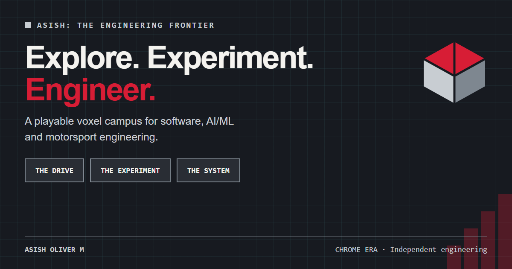
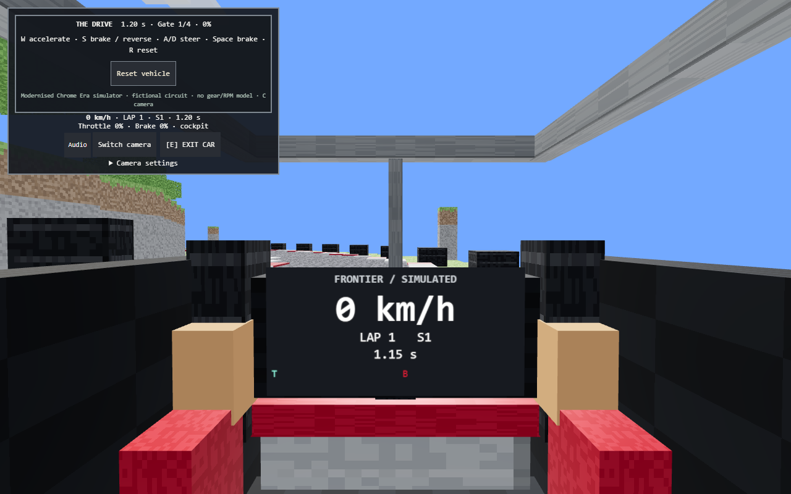
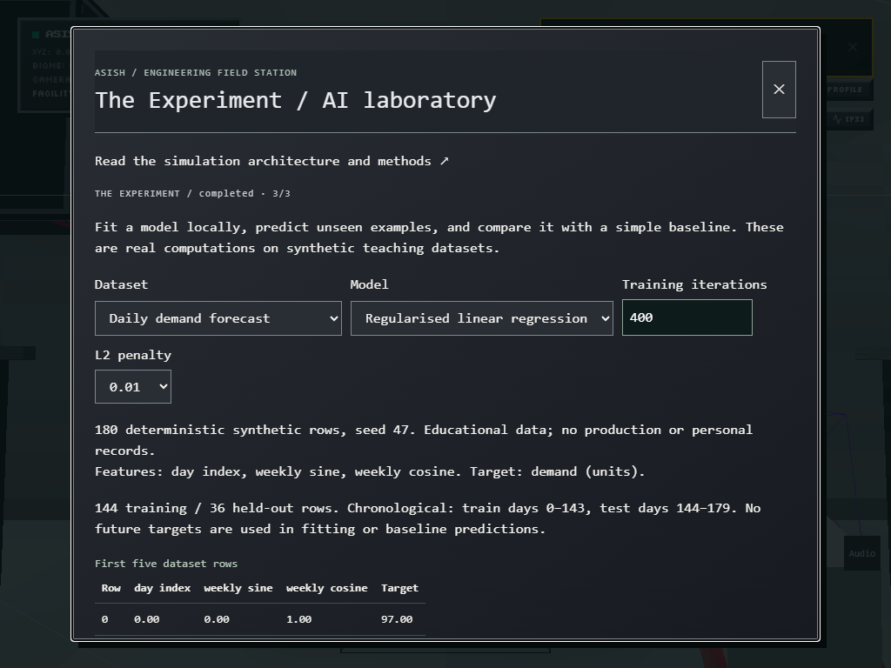

# ASISH: THE ENGINEERING FRONTIER



An explorable voxel engineering campus by **Asish Oliver M**, Integrated M.Tech Computer Science & Engineering student at VIT-AP. Visitors can participate in local software, AI/ML and motorsport demonstrations, then inspect their methods and source evidence.

**Status:** local release candidate. No public live demo has been published from this checkout. Vercel is the selected host; initial deployment requires owner approval. See [production readiness](docs/PRODUCTION_READINESS.md).

## Playable engineering

- **The Drive:** inspect the original voxel single-seater, enter its 3D cockpit, drive through four ordered gates, then inspect simulated telemetry, sector/reference comparisons and a recorded top-down replay. JSON export is available. The educational model omits tyre, aero and transmission dynamics.
- **The Experiment:** fit local models to seeded synthetic classification, regression and forecasting datasets. Inspect splits, held-out metrics and explicit baselines.
- **The System:** diagnose seven event-pipeline faults, apply actual repair transformations and validate recovered output. Timing and throughput describe a local simulation.

Recruiter, Developer, AI/ML Engineer, Motorsport Engineer and Explorer journeys share the same world. Routes are optional and never restrict resume, projects or contact access. `/visit` provides the shared field guide; `/recruiter`, `/projects` and `/engineering` work without WebGL.

## Actual captures

| Cockpit and steering | Experiment and evaluation |
| --- | --- |
|  |  |

[Mobile cockpit](docs/screenshots/cockpit-touch.png) · [Pipeline mission](docs/screenshots/frontier-system.png) · [Lap analysis](docs/screenshots/frontier-drive-debrief.png)

Captures are browser evidence, not a claim of real-world racing or production ML performance.

## Controls

On foot: WASD/arrows move, Shift runs, Space jumps, V switches perspective, E interacts and M opens the map. Click the viewport for mouse look; Escape releases it. Use the wheel to adjust third-person distance. Touch controls provide movement, look, jump, run and interaction.

Driving: W/S accelerate or brake/reverse, A/D steer, Space brakes, C switches camera (configurable to B; V also works), R resets and E exits. Cockpit FOV and seating are adjustable. Audio starts muted; mute and volume controls are available.

## Architecture

Next.js 15.5.29 App Router · React 19 · TypeScript · React Three Fiber 9 · Three.js 0.180 · Zustand · Tailwind CSS.

| Module | Responsibility |
| --- | --- |
| `app/` | Server-rendered professional routes and client-only world entry |
| `components/world`, `components/camera` | Voxel scene, player/camera control and fallback |
| `lib/frontier/` | Pure vehicle, ML, pipeline and mission logic |
| `state/` | Separate player, camera, mission, visitor and published drive state |
| `data/projects.ts`, `data/projectEvidence.ts` | Canonical project content and evidence adapter |
| `components/frontier`, `components/visitor` | Accessible stations, journeys and exhibit depth |
| `tests/`, `scripts/qa-*.mjs` | Behavioral tests and reproducible browser journeys |

Physics advances at 60 fixed steps per simulated second; recorded telemetry and the in-world texture publish at 10 Hz. The cockpit reads the same simulation state. Evidence pages distinguish local measured behavior, repository-reported results and unverified owner narratives. [Architecture and implementation](docs/FINAL_REPOSITORY_AUDIT.md).

## Local development

Use Node.js 24.x, as declared in package.json. This release candidate passes locked installation, TypeScript, lint, 51 tests and production build on Node 24.22.2. A hosted Vercel build remains a separate verification gate.

```sh
npm ci
npm run dev
npm run typecheck
npm run lint
npm test
npm run build
```

Core gameplay has no required runtime environment variables. See [.env.example](.env.example). Deployment credentials stay in the Vercel credential store.

For browser QA, start `npm run start -- --port 3005`, then run the relevant scripts in another terminal:

```sh
npm run test:qa
npm run test:visitors
node scripts/qa-cockpit.mjs
node scripts/qa-controls-release.mjs
node scripts/qa-release-final.mjs
node scripts/qa-production.mjs
```

Scripts currently use Windows Chrome at `C:/Program Files/Google/Chrome/Application/chrome.exe`. `qa-stations.mjs` accepts `QA_URL`. [Executed results and limits](docs/PRODUCTION_READINESS.md) · [Performance sample](docs/PERFORMANCE_REPORT.md) · [Security review](docs/SECURITY_REVIEW.md).

## Hosting and release

Vercel is selected. No project has been linked or deployed from this checkout. Vercel classifies a new project's first deployment as production, even with a preview target; obtain explicit approval before that step. [Deployment and rollback runbook](docs/DEPLOYMENT_RUNBOOK.md). Feature freeze follows the five-audience verification; new ideas belong in the [post-launch backlog](docs/POST_LAUNCH_BACKLOG.md).

## Licensing and asset provenance

No repository LICENSE was supplied. This README does not grant a new license; the owner must select the intended code/asset license before advertising reuse rights. Third-party package licenses remain their own. Google Fonts are requested at runtime with monospace fallbacks. The original scene/car geometry is code-built; an unused legacy team-branded photo is excluded from Vercel uploads pending provenance review. Avatar and other existing asset provenance still needs owner confirmation. No official Formula 1 or team affiliation is claimed.

## Professional links

[GitHub](https://github.com/T-Bone47) · [Source repository](https://github.com/T-Bone47/Minecraft-folio) · [Configured LinkedIn](https://www.linkedin.com/in/asish-oliver-56b454324) · [Email](mailto:dreamteamoliver@gmail.com) · [Resume](public/Asish_Oliver_M_Resume.pdf)

LinkedIn blocks the automated reachability check; owner confirmation is pending. Professional history and extended project narratives remain owner-supplied. [Launch copy and demo storyboard](docs/LINKEDIN_GITHUB_LAUNCH_KIT.md).

## Chrome Era edition

The campus now uses shared silver, graphite, carbon and racing-red materials, original ASISH signage, a modernised chrome-liveried car, bright technical garage and neutral pixel-metal facilities. [Before/after gallery and regression report](docs/CHROME_ERA_BROWSER_QA.md) · [Design tokens](docs/CHROME_ERA_DESIGN_SYSTEM.md) · [Asset provenance](docs/CHROME_ERA_ASSET_PROVENANCE.md). Historical styling is inspiration, with no official team or driver affiliation.

## Race Engineer avatar

The player, garage crew and HQ preview share an original articulated Chrome Era engineer: silver/red jacket, layered hair, headset, microphone, wrist device and utility radio. V switches perspective; mouse look orbits the idle third-person character. Walking/running animation follows resolved movement, with jump/fall, landing and station-reading poses. Hotbar tools remain equipped.

`/avatar` provides full-body inspection with front/side/back buttons, drag orbit and zoom. The spawn and profile portrait is rendered from this same model. [Implementation, screenshots and QA](docs/AVATAR_UPGRADE.md).

## Final release audit

The complete source candidate is prepared on `codex/release-candidate-2026-11-08`. See [final release decision](docs/FINAL_RELEASE_DECISION.md), [audit and fixes](docs/FINAL_PORTFOLIO_AUDIT.md), [CI setup](docs/CI_VALIDATION.md) and [Vercel runbook](docs/VERCEL_DEPLOYMENT_RUNBOOK.md). Unconfigured or preview environments deliberately use noindex and omit canonical claims; set SITE_ORIGIN only after confirming the actual production hostname. Main/public deployment requires separate release approval.


