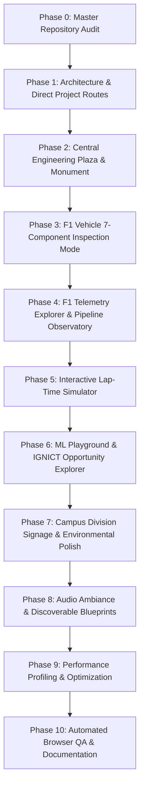

# ASISH: THE ENGINEERING FRONTIER — Enhancement Roadmap

**Product**: ASISH: THE ENGINEERING FRONTIER  
**Identity**: Interactive 3D Voxel Engineering Universe  
**Canonical Identity**: Asish Oliver M — Motorsport Software Engineer & AI/ML Engineer  
**Canonical GitHub**: [https://github.com/T-Bone47](https://github.com/T-Bone47)  
**Date**: November 2026  
**Auditor**: Principal Software Architect & Senior Game Systems Engineer  

---

## 1. Vision & Core Principles

**ASISH: THE ENGINEERING FRONTIER** is an explorable Minecraft-inspired engineering universe where visitors physically discover real engineering systems, interact with technical demonstrations, explore research facilities, and understand the deep software engineering behind each system.

### Principles:
1. **Never Replicate ASISH OS**: No floating desktop windows, no window managers, no OS dashboard metaphor. Exploration is physical, spatial, and first-person.
2. **Zero Fabrication**: 0 invented metrics, 0 fake telemetry logs, 0 unverified claims. All demonstrations clearly distinguish real recorded data, deterministic mathematical models, and illustrative educational simulations.
3. **Physical-World Primacy**: Projects have physical locations, machines, monitors, and terminals in the world.
4. **Instant Recruiter Accessibility**: Essential career information (resume, top projects, GitHub, LinkedIn, contact) is always discoverable within seconds without requiring 3D exploration.

---

## 2. Phased Enhancement Roadmap

---

### Phase 0 — Master Repository Audit
- **Goal**: Full audit of existing code, verifying zero regression, and documenting status across all systems.
- **Deliverables**: `docs/COMPLETION_AUDIT.md`, `docs/ENHANCEMENT_ROADMAP.md`, `docs/ARCHITECTURE_DECISIONS.md`.
- **Status**: **COMPLETED AND VERIFIED**

---

### Phase 1 — Architecture, Product Identity & Direct Routes
- **Goal**: Establish canonical identity **ASISH: THE ENGINEERING FRONTIER** across titles, README, and metadata. Add direct project routes `app/projects/page.tsx` and `app/projects/[slug]/page.tsx` as static aliases to `/work` and `/work/[slug]`.
- **Deliverables**:
  - `app/projects/page.tsx` & `app/projects/[slug]/page.tsx`
  - Update `README.md` and `data/site.ts` with product title **ASISH: THE ENGINEERING FRONTIER**.
- **Status**: **READY FOR EXECUTION**

---

### Phase 2 — Central Engineering Plaza & Landmark Monument
- **Goal**: Transform the spawn coordinate `[0, 0, 0]` into a distinctive, visually impressive Central Engineering Plaza.
- **Deliverables**:
  - `components/world/CentralPlaza.tsx`:
    - Voxel Engineering Obelisk / Compass Monolith rising from the central crossroads.
    - Campus Welcome Pedestal with interactive introduction and map trigger.
    - Directional voxel signposts pointing toward all 6 campus divisions.
- **Status**: **READY FOR EXECUTION**

---

### Phase 3 — F1 Vehicle Multi-Component Inspection Mode
- **Goal**: Create an engineering-grade vehicle inspection experience inside the F1 Garage (`components/garage/`).
- **Deliverables**:
  - Dedicated interactive modal / inspection overlay in `components/hud/StationModal.tsx`:
    - 7 component viewpoints:
      1. Front Wing (ground effect, outwash vortex generators)
      2. Rear Wing & DRS Actuator (high-downforce wing element)
      3. Pirelli P Zero Tyres & Thermal Dynamics (thermal degradation, carcass vs surface delta)
      4. Pushrod / Pullrod Suspension Geometry (camber, caster, ride height stiffness)
      5. Carbon Composite Monocoque Chassis (FIA crash structure, cockpit ergonomics)
      6. Steering Wheel & Driver Displays (rotary dials, brake bias, differential settings)
      7. Underfloor Venturi Tunnels & Diffuser (ground effect suction, boundary layer control)
- **Status**: **READY FOR EXECUTION**

---

### Phase 4 — Interactive F1 Telemetry Explorer & Data Pipeline Observatory
- **Goal**: Build working interactive demonstrations for Live F1 Intelligence and Race Control.
- **Deliverables**:
  - **F1 Telemetry Explorer** (`StationModal.tsx`):
    - Session selection (Bahrain GP Pole Lap vs Monza GP High-Speed vs Silverstone Wet/Dry).
    - Speed trace, Throttle trace, Brake trace, Gear overlay.
    - Sector comparison and delta timing readout.
  - **Data Pipeline Observatory**:
    - Interactive 6-stage telemetry ingestion gantry:
      - Source -> Ingestion Queue -> Schema & CRC Validation -> Normalization -> Processing Core -> WebSocket Buffer.
    - Clickable stages displaying throughput (msgs/sec), latency (ms), and sample payload JSON.
- **Status**: **READY FOR EXECUTION**

---

### Phase 5 — Interactive Lap-Time Simulator & Vehicle Dynamics Model
- **Goal**: Enhance the Simulation Lab with interactive parameter controls.
- **Deliverables**:
  - Interactive parameter controls in `StationModal.tsx` (`simulation_runner`):
    - Aerodynamic Downforce: Low Wing (Monza) / Medium Wing (Spa) / High Wing (Monaco)
    - Tyre Compound: Soft C4 / Medium C3 / Hard C2
    - Engine Power Mode: Full Qualifying / Standard Race / Fuel-Save Derate
    - Track Grip Multiplier: Low Grip (Green Track) / High Grip (Rubbered In)
  - Dynamically computes:
    - Estimated lap time delta (e.g. 1:19.420)
    - Corner apex speed in high-speed turns
    - Heavy braking distance delta
    - Parameter sensitivity analysis and mathematical assumptions (quasi-static point-mass solver).
- **Status**: **READY FOR EXECUTION**

---

### Phase 6 — ML Playground & IGNICT Opportunity Matching Explorer
- **Goal**: Build interactive AI/ML demonstrations inside the AI Research Division.
- **Deliverables**:
  - **ML Playground**:
    - Dataset selection: F1 Tyre Degradation vs EA FC Player Embeddings vs VyaparPulse Retail Demand.
    - Model selection: XGBoost vs Multi-Layer Perceptron vs Cosine Similarity vs Ridge Regression.
    - Displays: Confusion matrix, Accuracy, Precision/Recall, Feature Importance chart.
  - **IGNICT Opportunity Matching Explorer**:
    - Synthetic candidate profile and opportunity requirements.
    - Adjustable skill weights: NLP, Vector Search, Distributed Systems, PyTorch, Real-Time Architecture.
    - Computes: Dynamic cosine match score (e.g. 94.2%), candidate ranking, and match justification.
- **Status**: **READY FOR EXECUTION**

---

### Phase 7 — Campus Division Signage & Environmental Polish
- **Goal**: Enhance environmental storytelling across all campus roads and paths.
- **Deliverables**:
  - In-world directional signs placed along footpaths.
  - Distinctive division color accents and lighting fixtures.
  - Clear visual landmarks visible from afar.
- **Status**: **READY FOR EXECUTION**

---

### Phase 8 — Audio Ambiance & Discoverable Blueprints
- **Goal**: Add subtle, tasteful ambient audio effects and collectible engineering blueprints.
- **Deliverables**:
  - Facility-specific WebAudio ambient soundscapes (wind at Telemetry Tower, garage hum, AI lab pulse).
  - Collectible technical blueprint plaques hidden around campus.
- **Status**: **READY FOR EXECUTION**

---

### Phase 9 — Performance Profiling & Optimization
- **Goal**: Maintain 60 FPS across all viewports with zero memory leaks.
- **Deliverables**:
  - Measure FPS, draw calls, triangles, and texture memory.
  - Validate LOD and chunking.
  - Document before-and-after measurements in `docs/PERFORMANCE_REPORT.md`.
- **Status**: **READY FOR EXECUTION**

---

### Phase 10 — Automated Browser QA, Testing & Final Documentation
- **Goal**: End-to-end browser verification of all new features with screenshots and updated documentation.
- **Deliverables**:
  - Update `tests/engineering-world.test.ts`.
  - Update `scripts/run-browser-qa.mjs` to test all new technical demonstrations.
  - Generate screenshots for each new demonstration.
  - Update `docs/COMPLETION_AUDIT.md`, `docs/PROJECT_EXHIBITS.md`, `docs/QA_REPORT.md`, `docs/DEPLOYMENT_CHECKLIST.md`.
- **Status**: **READY FOR EXECUTION**

