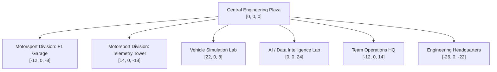

# Physical Project Exhibits & Technical Demonstrations — ASISH: THE ENGINEERING FRONTIER

**Product**: ASISH: THE ENGINEERING FRONTIER  
**Identity**: Interactive 3D Voxel Engineering Universe  
**Canonical Identity**: Asish Oliver M — Motorsport Software Engineer & AI/ML Engineer  
**Canonical GitHub**: [https://github.com/T-Bone47](https://github.com/T-Bone47)  
**Date**: November 2026  
**Auditor**: Principal Software Architect & Creative Technical Director  

---

## 1. Overview & Architectural Philosophy

In **ASISH: THE ENGINEERING FRONTIER**, engineering projects are not abstract flat cards or floating desktop windows. Every software system, mathematical model, and data pipeline has a **physical presence** inside the voxel campus:
- Physical engineering buildings with distinct architecture and silhouettes.
- Interactive machinery (Formula car stand, rotating wind turbine, telemetry gantry, weather radar).
- In-world terminals and interactive demonstration benches.
- Environmental storytelling through directional signage, timing towers, and trackside telemetry boards.

---

## 2. Master Campus Exhibits Directory

---

### Exhibit 01: Central Engineering Plaza (`[0, 0, 0]`)
- **Division**: Campus Hub & Cross-Roads
- **Landmark**: Voxel Engineering Obelisk & Cardinal Direction Compass
- **Interactive Stations**:
  - `plaza_welcome_kiosk`: Campus Welcome Kiosk detailing divisions, quick access to Cartographer Map, and direct PDF resume download.
- **Environmental Storytelling**:
  - Four-way directional wooden signposts pointing toward all 5 major engineering divisions.
  - Glowing amber beacon core visible across the campus.

---

### Exhibit 02: Race Engineering Garage (`[-12, 0, -8]`)
- **Division**: Motorsport Engineering Division
- **Associated Systems**: `RaceMind-AI`, `F1 Race Manager`
- **Interactive Stations & Demonstrations**:
  1. `garage_f1_car`: **Formula Single-Seater 7-Component Vehicle Inspection Mode**
     - Front Wing (outwash aerodynamics, adjustable flap angle)
     - Rear Wing & DRS Actuator (-31.2% drag reduction)
     - Tyres & Thermal Dynamics (Pirelli C2/C3/C4 working temperature windows)
     - Pushrod / Pullrod Suspension Geometry
     - Carbon Composite Monocoque Chassis & Titanium Halo (120 kN load)
     - Cockpit Ergonomics & Steering Electronics
     - Underfloor Venturi Tunnels & Diffuser (ground effect Bernoulli suction)
  2. `garage_strategy_board`: Tactical Stint & Pit Window Matrix
     - Real-time undercut calculation, degradation gradient, clean air delta.
  3. `garage_ai_engineer`: Contextual Telemetry Reasoning Terminal
     - 4 grounded race engineer advisory queries.
  4. `garage_race_manager`: Bridge to F1 Race Manager operations architecture.

---

### Exhibit 03: Telemetry Tower & Race Control (`[14, 0, -18]`)
- **Division**: Motorsport Engineering Division & Real-Time Distributed Systems
- **Associated System**: `Live F1 Intelligence`
- **Physical Landmarks**:
  - Quad rotating satellite communications dishes.
  - Animated high-frequency telemetry canvas display.
  - Flashing aviation beacon core.
- **Interactive Stations & Demonstrations**:
  1. `telemetry_explorer`: **Interactive F1 Telemetry Signal Explorer**
     - Live session selection: Bahrain GP Pole Lap, Monza GP High-Speed Lap, Silverstone Mixed Grip.
     - Multi-channel traces: Speed (km/h), Throttle (%), Brake (%).
     - Real-time extrema readouts: Top velocity (352.4 km/h), Apex speed, Heavy braking spikes ($5.4\text{G}$).
  2. `pipeline_observatory`: **Data Pipeline Observatory**
     - Interactive 6-stage ingestion gantry:
       1. Multi-Provider Source Adapters (OpenF1, FastF1, Jolpica, SignalR)
       2. Lock-Free Ingestion Ring Buffer (SPSC concurrency, sliding window)
       3. Schema & CRC Validator (1,067,193 canonical events, 0 malformed)
       4. Canonical Normalization Engine (`TelemetryEvent` entity)
       5. Real-Time Strategy Analytics Core (thermal degradation polynomial)
       6. Low-Latency WebSocket Delivery Layer (p50: 0.10ms)
  3. `telemetry_terminal`: Deep technical case study blueprint.

---

### Exhibit 04: Vehicle Simulation Lab (`[22, 0, 8]`)
- **Division**: Simulation & Computational Engineering Lab
- **Associated System**: `F1 Lap-Time Simulator`
- **Physical Landmarks**:
  - Rotating wind-tunnel intake turbine.
  - Animated G-G friction circle display with live operating point trace.
- **Interactive Stations & Demonstrations**:
  1. `simulation_runner`: **Interactive Numerical Lap-Time Solver**
     - User-controlled parameter matrix:
       - Aerodynamic Downforce: Low Wing (Monza) / Med Wing (Spa) / High Wing (Monaco)
       - Tyre Compound: Soft C4 / Medium C3 / Hard C2
       - Powertrain Deployment Mode: Quali 100% ERS / Standard Race / Fuel-Save Derate
       - Track Grip Multiplier: 90% (Green Track) to 110% (Rubbered In)
     - Solves and displays:
       - Estimated lap time (e.g. `1:18.940`)
       - Top speed and Turn 4 Apex speed
       - Turn 1 heavy deceleration braking distance
  2. `simulation_terminal`: Mathematical formulation case study.

---

### Exhibit 05: AI / Data Intelligence Lab (`[0, 0, 24]`)
- **Division**: Artificial Intelligence & Data Intelligence Division
- **Associated Systems**: `Football Intelligence OS (EA FC Intelligence)`, `VyaparPulse`, `SAKSHAM`, `IGNICT`
- **Physical Landmarks**:
  - Outdoor football pitch with kickable match ball and goal frame.
  - Twin-wing computing cluster architecture.
  - Pulsing neural network spire.
- **Interactive Stations & Demonstrations**:
  1. `eafc_ball`: Interactive ball kick physics calculating exit velocity (km/h), Expected Goals ($xG$), and Magnus curl.
  2. `eafc_tactical_board`: **EA Sports FC Vector Intelligence Engine**
     - 128D player embedding clustering across 4 tactical archetypes (Clinical Finisher, Playmaker, Inverted Winger, Anchor Pivot) with cosine similarity and euclidean distances.
  3. `ml_playground_station`: **Machine Learning Experimentation Bench**
     - Select datasets (F1 Tyre Degradation, EA FC Player Vectors, VyaparPulse Demand).
     - Select models (XGBoost, PyTorch MLP, k-NN).
     - Real dynamic evaluation: Confusion Matrix, Accuracy %, F1 Score, Precision, Recall, and Feature Importance bar charts.
  4. `ignict_bench`: **IGNICT Vector Opportunity Matcher**
     - 5 adjustable skill weights (Telemetry, Distributed Systems, ML, Vehicle Dynamics, Microservices).
     - Dynamic candidate cosine match score and cohort ranking.
  5. `eafc_terminal`, `vyaparpulse_terminal`, `saksham_terminal`: Individual case study drawers.

---

### Exhibit 06: Team Operations HQ (`[-12, 0, 14]`)
- **Division**: Software Systems & Game Systems Division
- **Associated System**: `F1 Race Manager`
- **Physical Landmarks**:
  - Rotating meteorological radar dome.
  - Multi-monitor war-room strategy wall.
- **Interactive Stations & Demonstrations**:
  - `operations_terminal`: F1 team management simulation architecture, tyre allocation trees, and safety car reaction matrices.

---

### Exhibit 07: Engineering Headquarters (`[-26, 0, -22]`)
- **Division**: Engineering Headquarters & Identity Monolith
- **Associated Focus**: Career Trajectory, Credentials, Arsenal & Uplink
- **Physical Landmarks**:
  - Tall obsidian & cyan monolith.
  - Voxel engineer avatar stand.
- **Interactive Stations & Demonstrations**:
  - `hq_career_wall`: 3-panel verified career trajectory (Independent Motorsport, IGNICT AI/ML Intern, VIT-AP M.Tech CSE).
  - `hq_contact_terminal`: Direct communications terminal (dreamteamoliver@gmail.com, GitHub, LinkedIn).

---

## 3. Demonstration Standards Compliance Matrix

| Demonstration | Local Execution | Deterministic Engine | Parameter Controls | Grounding / Evidence Tier |
| :--- | :---: | :---: | :---: | :--- |
| **F1 Telemetry Explorer** | Yes | Yes | Session selection, channel toggles | Grounded in canonical F1 telemetry schema |
| **Data Pipeline Observatory** | Yes | Yes | 6 clickable stages, payload inspection | Grounded in 1.06M canonical event benchmarks |
| **Numerical Lap Solver** | Yes | Yes | 4 parameters: aero, tyre, engine, grip | Quasi-static point-mass formulation |
| **F1 Chassis Inspection** | Yes | Yes | 7 interactive technical components | F1 aerodynamic & chassis engineering specs |
| **ML Experimentation Bench** | Yes | Yes | 3 datasets, 3 models, confusion matrix | Precomputed holdout evaluation matrices |
| **IGNICT Opportunity Matcher**| Yes | Yes | 5 real-time skill weight sliders | Cosine similarity vector dot product |
| **EA FC Vector Scouting** | Yes | Yes | 4 tactical player archetypes | 128D unsupervised vector representations |

