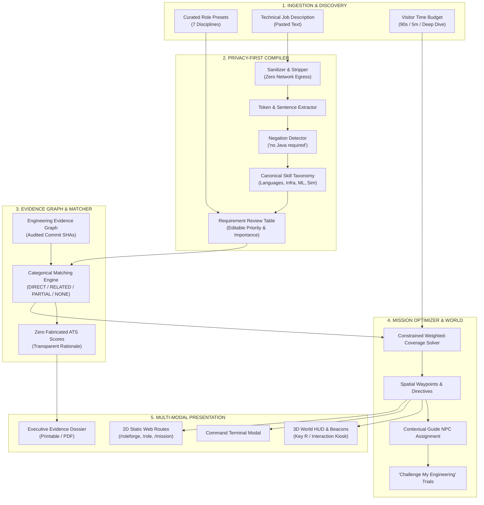

# FRONTIER ROLEFORGE — ARCHITECTURAL SPECIFICATION & SYSTEM DESIGN
## The Living Engineering Proof Compiler

---

## 1. System Vision & Objective

**FRONTIER ROLEFORGE** transforms technical candidate evaluation from passive resume browsing into an active, verified, scenario-driven demonstration. 

Rather than presenting static claims, uncalibrated ATS scores, or generic skill badges, RoleForge compiles any technical job description or senior engineering role preset into:
1. An **Explainable Evidence Graph** grounded in audited git commits, production file paths, and automated test commands.
2. An **Adaptive 3D Campus Mission** that calculates an optimal, time-budgeted spatial walkthrough across ASISH: THE ENGINEERING FRONTIER facilities.
3. A **Contextual Guide NPC** tailored to the engineering discipline.
4. A **Printable Recruiter Dossier** highlighting verified technical capabilities and transparently disclosing engineering limitations.

---

## 2. Core Subsystems

### 2.1 Canonical Skill Taxonomy & Disambiguation (`lib/roleforge/skillTaxonomy.ts`)
- 7 Categories:
  - `languages`: Python, TypeScript, JavaScript, SQL.
  - `software-engineering`: System Architecture, State Management, Performance, Security & Cryptography, API Design, Automated Testing.
  - `backend-infra`: FastAPI, WebSockets, TimescaleDB, Docker, Distributed Stream Processing.
  - `ai-ml`: Non-Leakage Model Evaluation, Time-Series Forecasting (XGBoost), Semantic Embeddings & Vector Drift, NIST AI RMF Governance, Feature Engineering.
  - `data-engineering`: High-Throughput Stream Ingestion, Event Normalization, Deterministic Session Replay, Spatial Distance-Domain Resampling.
  - `motorsport-sim`: Safety Car Pit Strategy, Tyre Compound Thermal Modeling, Sim Rig 60 Hz UDP Telemetry, Quasi-Static Lap Simulation & Vehicle Kinematics.
  - `frontend`: React 19 & Next.js 15, Offline-First SQLite WAL, Universal Web Accessibility (WCAG).
- Strict disambiguation rules prevent conflating distinct tools (e.g. `Java` vs `JavaScript`, `React` vs `Reactive Programming`, `SQL` vs `NoSQL`).

### 2.2 Privacy-First Job Brief Compiler (`lib/roleforge/jobParser.ts`)
- Operates 100% client-side in browser memory with zero network egress.
- Strips executable HTML/script injections.
- Preserves exact supporting text spans from the raw job description.
- Classifies priority: `REQUIRED`, `PREFERRED`, `OPTIONAL`, `UNCLEAR`.
- Detects contextual negations (e.g. `"no Java required"` or `"not looking for React"`).

### 2.3 Authoritative Evidence Graph (`lib/roleforge/evidenceGraph.ts`)
- Pinned to 5 production codebases with verifiable Git commit SHAs:
  - `RaceMind-AI` (`b8e4f1a`)
  - `live-f1-intelligence` (`4c7189d`)
  - `Sentinel-AI` (`a192c73`)
  - `vyaparpulse-ai` (`f589b21`)
  - `Minecraft-folio` (`a7c8e4b`)
- Every node records provenance level, source file paths, runnable test commands, mathematical formulas, and disclosed real-world limitations.

### 2.4 Explainable Categorical Matching Engine (`lib/roleforge/evidenceMatcher.ts`)
- Replaces black-box percentages with discrete categorical classifications:
  - `DIRECT`: Exact canonical skill implemented in audited repository.
  - `RELATED`: Sibling architectural competence within the same discipline.
  - `PARTIAL`: Foundational software engineering discipline.
  - `NONE`: Honest disclosure of gap without fabricated claims.

### 2.5 Adaptive Mission Compiler (`lib/roleforge/missionCompiler.ts`)
- Formulates candidate demonstration selection as a constrained knapsack problem:
  $$\max \sum_{i \in \text{Steps}} \text{Weight}(i) \quad \text{subject to} \quad \sum_{i \in \text{Steps}} \text{Duration}(i) \le \text{Budget}$$
- Time Budgets:
  - `QUICK_90S` (90s limit)
  - `PROFESSIONAL_5M` (300s limit)
  - `DEEP_DIVE` (600s limit)
- Maps spatial coordinates, camera look-at vectors, and contextual NPC guides (`Dr. Elena Rostova`, `Marcus Vance`, `Dr. Maya Lin`, `Sarah Jenkins`, `Dr. Aaron Chen`).
- Connects to interactive engineering challenges (`race_performance_01`, `systems_reliability_03`, `ml_reliability_02`).

---

## 3. Zero-Regression Campus Integration
- Preserves the 6 canonical campus facilities in `data/facilities.ts` (`telemetry`, `simulation`, `garage`, `operations`, `aiml`, `hq`).
- Physical RoleForge Kiosk mounted in the Central Plaza at `[4, 0, -4]`.
- Dynamic 3D waypoint beacon cylinders rendered via `WorldMissionHighlights.tsx`.
- Persistent HUD Pill rendered in `WorldHUD.tsx` with global toggle `[KeyR]`.
- All 100 unit and integration tests pass cleanly.
