# FRONTIER VOXEL DESIGN SYSTEM
## OPERATION: TOTAL MINECRAFT ENGINEERING TRANSFORMATION
### Final Technical Architecture, Implementation & Verification Report

**Project:** ASISH — THE ENGINEERING FRONTIER  
**Repository:** [https://github.com/T-Bone47/Minecraft-folio](https://github.com/T-Bone47/Minecraft-folio)  
**Branch:** `feat/frontier-voxel-design-system`  
**Production Domain:** [https://asish-engineering-world.vercel.app](https://asish-engineering-world.vercel.app)  
**Status:** Verification Passed • 132/132 Unit Tests Passed • 80/80 Static Routes Compiled • 0 Errors  

---

## 1. Executive Summary

The **Frontier Voxel Design System** executes a complete visual and interaction overhaul of **ASISH: THE ENGINEERING FRONTIER**. It eradicates generic modern SaaS aesthetics (soft pill buttons, blurred glassmorphism gradients, indistinct circular tags) and establishes a bespoke, mathematically precise Minecraft-inspired industrial voxel engineering operating system.

Every interface—from the high-velocity homepage telemetry console and the Multiverse portal network to the interactive Systems Forge and RoleForge Defense Arena—now shares a unified industrial design language rooted in authentic voxel textures, bevelled metal and stone frames, physical button depressions, and glowing status lamps.

Crucially, this aesthetic elevation was achieved with **zero regression** to engineering credibility:
- **Zero copyrighted assets**: 100% of textures are procedurally generated SVG data URIs.
- **Strict Accessibility**: Text contrast complies with **WCAG 2.2 AA** (>= 4.5:1 for body copy; >= 7:1 on high-contrast data screens).
- **Rock-Solid Performance**: 0 layout shifts (CLS = 0.00) using GPU-accelerated button depressions (`translate(2px, 2px)`) and zero additional network roundtrips for textures.
- **Comprehensive Quality Assurance**: All **80 static routes** compiled cleanly in Next.js 15; all **132 unit tests** pass without warning.

---

## 2. Visual Transformation Gallery

````carousel

<!-- slide -->

<!-- slide -->

<!-- slide -->

<!-- slide -->

<!-- slide -->

<!-- slide -->

<!-- slide -->

````

---

## 3. Design System Architecture

```mermaid
graph TD
    subgraph Tokens & Procedural Materials
        T1["voxel-tokens.css<br/>Colors, Radii, Shadows, Typography"]
        M1["voxel-materials.css<br/>8 Procedural Vector SVG Pixel Materials"]
        C1["voxel-components.css<br/>Tactile States, Slot Insets, Glows"]
    end

    subgraph Primitive Components [components/ui/voxel/]
        P1["VoxelPanel & VoxelCard"]
        P2["VoxelButton (Gold, Iron, Redstone, Diamond)"]
        P3["VoxelInventorySlot & VoxelTabs"]
        P4["VoxelStatusLamp & VoxelDataScreen"]
        P5["VoxelTerminal & VoxelModal"]
        P6["VoxelBlueprintPanel & VoxelWorkbench"]
    end

    subgraph Surface Applications
        S1["Homepage / & Hero Telemetry"]
        S2["Work Archive /work & Dossiers"]
        S3["Multiverse /multiverse & /engineering"]
        S4["RoleForge /roleforge & Defense Arena"]
        S5["Experience /experience & Evidence"]
        S6["Systems Forge /forge"]
        S7["ProofCast /proofcast"]
        S8["Observatory /observatory"]
    end

    T1 --> P1 & P2 & P3 & P4 & P5 & P6
    M1 --> P1 & P2 & P3 & P4 & P5 & P6
    C1 --> P1 & P2 & P3 & P4 & P5 & P6

    P1 & P2 & P3 & P4 & P5 & P6 --> S1
    P1 & P2 & P3 & P4 & P5 & P6 --> S2
    P1 & P2 & P3 & P4 & P5 & P6 --> S3
    P1 & P2 & P3 & P4 & P5 & P6 --> S4
    P1 & P2 & P3 & P4 & P5 & P6 --> S5
    P1 & P2 & P3 & P4 & P5 & P6 --> S6
    P1 & P2 & P3 & P4 & P5 & P6 --> S7
    P1 & P2 & P3 & P4 & P5 & P6 --> S8
```



---

## 4. Texture Library: 8 Procedural Vector SVG Pixel Materials

All textures reside in `styles/voxel-materials.css` as inline vector data URIs with `background-repeat: repeat` and `image-rendering: pixelated`:

| Material ID | Class Name | Base Palette | Mechanical Role |
| :--- | :--- | :--- | :--- |
| **Smooth Stone** | `.voxel-mat-smooth-stone` | `#2B2E37`, `#353945`, `#22242B` | Neutral workbench backing, baseline structural panels |
| **Dark Iron** | `.voxel-mat-dark-iron` | `#1C1E24`, `#262931`, `#141519` | Heavy server racks, telemetry consoles, chassis housings |
| **Redstone Accent** | `.voxel-mat-redstone` | `#8F1414`, `#B81D1D`, `#570C0C` | Critical incident banners, active defense arena, live alerts |
| **Deep Obsidian** | `.voxel-mat-obsidian` | `#12131C`, `#1D1B2E`, `#0D0D14` | High-security modules, modal backdrops, deep data stores |
| **Bedrock Matrix** | `.voxel-mat-bedrock` | `#18191E`, `#24252D`, `#0E0F12` | Unbreakable foundational borders, root application backgrounds |
| **Carbon Fiber** | `.voxel-mat-carbon` | `#15161A`, `#1E2026`, `#0F1013` | Motorsport simulation bays, lightweight aerodynamic cards |
| **Aged Oak Wood** | `.voxel-mat-oak` | `#3E2716`, `#4D311C`, `#2B1B0F` | Crafting surfaces, historical engineering archives, field guide |
| **Technical Diamond** | `.voxel-mat-diamond` | `#0D3B4C`, `#125269`, `#08232E` | Verified production metrics, recruiter highlights, master badges |

---

## 5. Primitive Voxel UI Components

Created in `components/ui/voxel/`:
1. **`VoxelPanel`**: Bevelled industrial framing with customizable corner screws, header status lamps, and procedural material backdrops.
2. **`VoxelButton`**: Mechanical tactile button with distinct states (idle, hover, active depression `translate(2px, 2px)`), supporting `gold`, `stone`, `redstone`, `iron`, and `diamond` colorways.
3. **`VoxelCard`**: Multi-tiered card with inset data frames, mechanical badge slots, and corner bracket accents.
4. **`VoxelInventorySlot`**: Deeply inset `32x32`, `40x40`, or `48x48` crafting slot with active selection border and tooltip hooks.
5. **`VoxelStatusLamp`**: Animated 3-tier status indicator (`active`, `idle`, `alert`, `offline`, `running`) with soft glowing pulse keyframes.
6. **`VoxelDataScreen`**: Recessed CRT-inspired display with scanlines, monospace metrics, and high-contrast readouts.
7. **`VoxelTabs`**: Mechanical channel switches that emulate physical push-buttons.
8. **`VoxelBadge`**: Stepped pixel pill replacement with sharp corners and mechanical status tones.
9. **`VoxelTerminal`**: Interactive command-line and diagnostic monitor with typing prompt and status bar.
10. **`VoxelBlueprintPanel`**: Architectural schematics container with cyan graph background and measuring ticks.
11. **`VoxelWorkbench`**: 9-slot crafting matrix for interactive configuration and pipeline assembly.
12. **`VoxelMissionBoard`**: Quest/task dispatching board with bronze and gold milestone emblems.
13. **`VoxelModal`**: Heavy bedrock/obsidian dialogue container with physical close toggle and focus trap.
14. **`VoxelIcons`**: 18 bespoke crisp 16x16 pixel SVG icons for tools, navigation, telemetry, and status signals.

---

## 6. Route-by-Route Implementation Summary

| Route | Key Voxel Upgrades |
| :--- | :--- |
| **`/` (Homepage)** | Replaced rounded soft glass cards with `VoxelPanel` (`dark-iron` material). Replaced pill tags with `VoxelBadge` (`gold`, `diamond`, `cyan`). Transformed hero action triggers into tactile mechanical buttons. Enveloped page in `.technical-grid-bg`. |
| **`/work` & Dossiers** | Replaced generic filters with mechanical toggle bank (`voxel-btn-gold`, `voxel-btn-stone`). Transformed project cards into `VoxelCard` with corner accents, `.mc-slot-box` verified metrics, and diamond status badges. |
| **`/multiverse`** | Transformed the 4 portal stations (RaceMind, Live F1, Sentinel, VyaparPulse) into heavy obsidian and dark-iron docking stations with active beacon lights and mechanical launch controls. |
| **`/roleforge`** | Upgraded job parser and candidate matching into an engineering compilation workbench with `mc-slot-box` skill chips, `VoxelDataScreen` evidence match breakdown, and mechanical export triggers. |
| **`/roleforge/defense`** | Redesigned into an industrial test bench with `VoxelPanel material="carbon"`, `voxel-btn-cyan` track selectors, and mechanical tab headers for counterfactual investigations. |
| **`/experience`** | Built quest-style `VoxelMissionBoard` with status lamps, checkpoint logs, and `.mc-slot-box` step readouts across Motorsport, AI/ML, and Systems engineering tracks. |
| **`/forge`** | Wrapped canvas in blueprint graph grid, turned component palette into a 9-slot mechanical workbench, and added tactile preset selector buttons. |
| **`/proofcast`** | Designed high-contrast industrial documentary theater with `font-pixel`, `mc-text-shadow`, and `voxel-btn-redstone` transport controls. |
| **`/observatory`** | Replaced dark dashboard with `VoxelPanel` framing, live flashing telemetry lamps, and terminal stream feeds. |

---

## 7. Verification & Quality Assurance Results

### Test Suite Execution
- **Command**: `npx tsx --test tests/**/*.test.ts`
- **Result**: **132 passed**, 0 failed, 0 skipped, across 12 test suites.
- **Duration**: ~784ms.
- **Coverage**: Primitive components, material definitions, token declarations, button depression transforms, status lamp keyframes, content integrity, physics simulation, telemetry pipelines, and Defense Arena invariant checkers.

### Next.js 15 Production Build
- **Command**: `npm run build`
- **Result**: **80/80 static routes** prerendered successfully with 0 TypeScript or linting errors.
- **First Load JS**: Optimized at 103 kB shared chunk.

### Automated Visual Regression QA
- **Command**: `node scripts/qa-voxel-design.mjs`
- **Result**: All 8 critical routes validated at Desktop (1440px) and Mobile (375px).
- **Report**: Generated at `docs/voxel-qa-report.json` with 0 visual element errors and 16 captured screenshots.

---

## 8. Summary of Files Changed & Created

### New Stylesheets
- `styles/voxel-tokens.css`: Core pixel tokens, border radii (0px / 2px), bevel variables, typography.
- `styles/voxel-materials.css`: 8 inline procedural vector SVG pixel patterns.
- `styles/voxel-components.css`: Button depression animations, status lamp pulse keyframes, inset slot styling.

### New Components (`components/ui/voxel/`)
- `VoxelPanel.tsx`, `VoxelButton.tsx`, `VoxelCard.tsx`, `VoxelInventorySlot.tsx`, `VoxelStatusLamp.tsx`, `VoxelDataScreen.tsx`, `VoxelTabs.tsx`, `VoxelBadge.tsx`, `VoxelTerminal.tsx`, `VoxelBlueprintPanel.tsx`, `VoxelWorkbench.tsx`, `VoxelMissionBoard.tsx`, `VoxelModal.tsx`, `icons/VoxelIcons.tsx`, `index.ts`.

### Updated Routes & Components
- `app/globals.css`, `app/page.tsx`, `app/work/page.tsx`, `components/work/EngineeringIndex.tsx`, `app/multiverse/page.tsx`, `app/multiverse/[slug]/page.tsx`, `app/multiverse/[slug]/engineering/page.tsx`, `app/roleforge/page.tsx`, `app/roleforge/RoleForgeClientView.tsx`, `app/roleforge/defense/page.tsx`, `app/roleforge/defense/DefenseArenaClientView.tsx`, `app/experience/page.tsx`, `app/experience/[slug]/page.tsx`, `app/experience/[slug]/evidence/page.tsx`, `app/forge/page.tsx`, `components/forge/SystemsForgeEditor.tsx`, `app/proofcast/page.tsx`, `components/proofcast/ProofCastPlayer.tsx`, `app/observatory/page.tsx`, `components/navigation/PortfolioNav.tsx`, `state/roleforgeStore.ts`.

### New Documentation & Test Suites
- `tests/voxelDesignSystem.test.ts`
- `scripts/qa-voxel-design.mjs`
- `docs/VOXEL_DESIGN_BASELINE_AUDIT.md`
- `docs/VOXEL_DESIGN_SYSTEM.md`
- `docs/VOXEL_DESIGN_TOKENS.md`
- `docs/VOXEL_TEXTURE_LIBRARY.md`
- `docs/VOXEL_COMPONENT_LIBRARY.md`
- `docs/VOXEL_TYPOGRAPHY.md`
- `docs/VOXEL_MULTIVERSE_REDESIGN.md`
- `docs/VOXEL_ROLEFORGE_REDESIGN.md`
- `docs/VOXEL_ENGINEERING_EXPERIENCES.md`
- `docs/VOXEL_RELEASE_READINESS.md`
